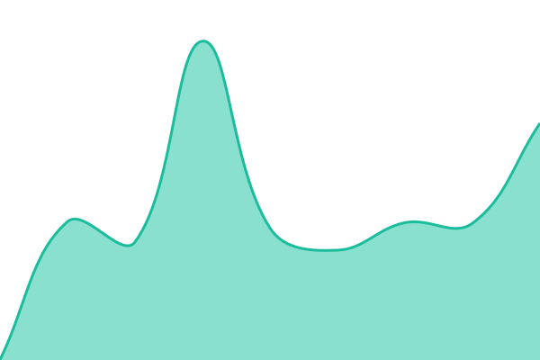
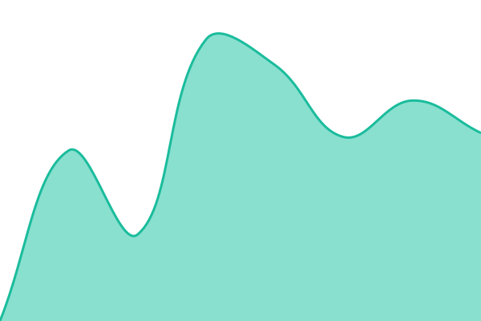

# [Yoorie Status](https://status.yoorie.com)

This repository contains the open-source uptime monitor and status page for [yoorie](https://status.yoorie.com), powered by [Upptime](https://github.com/upptime/upptime).

<!--start: status pages-->
<!-- This summary is generated by Upptime (https://github.com/upptime/upptime) -->
<!-- Do not edit this manually, your changes will be overwritten -->
<!-- prettier-ignore -->
| URL | Status | History | Response Time | Uptime |
| --- | ------ | ------- | ------------- | ------ |
|  [Yoorie Website](https://yoorie.com) | 🟩 Up | [yoorie-website.yml](https://github.com/yoorie/status/commits/HEAD/history/yoorie-website.yml) | 

 443ms
     
 | 

<a href="https://status.yoorie.com/history/yoorie-website">96.44%</a>
    

|  [Yoorie CRM & Client Portal](https://crm.yoorie.com/authentication/login) | 🟩 Up | [crm.yml](https://github.com/yoorie/status/commits/HEAD/history/crm.yml) | 

 666ms
     
 | 

<a href="https://status.yoorie.com/history/crm">96.54%</a>
    

|  [Yoorie App](https://app.yoorie.com/admin/login) | 🟩 Up | [app.yml](https://github.com/yoorie/status/commits/HEAD/history/app.yml) | 

 1690ms
     
 | 

<a href="https://status.yoorie.com/history/app">96.64%</a>
    

|  [Yoorie Booking](https://book.yoorie.com) | 🟩 Up | [booking.yml](https://github.com/yoorie/status/commits/HEAD/history/booking.yml) | 

 1228ms
     
 | 

<a href="https://status.yoorie.com/history/booking">96.73%</a>
    

|  [Yoorie Analytics](https://analytics.yoorie.com/matomo.js) | 🟩 Up | [analytics.yml](https://github.com/yoorie/status/commits/HEAD/history/analytics.yml) | 

 396ms
     
 | 

<a href="https://status.yoorie.com/history/analytics">96.83%</a>
    

|  [Yoorie Social](https://social.yoorie.com/up) | 🟩 Up | [social.yml](https://github.com/yoorie/status/commits/HEAD/history/social.yml) | 

 1239ms
     
 | 

<a href="https://status.yoorie.com/history/social">96.92%</a>
    

<!--end: status pages-->

Questions? Email [info@yoorie.com](mailto:info@yoorie.com). Powered by open-source [Upptime](https://github.com/upptime/upptime).
